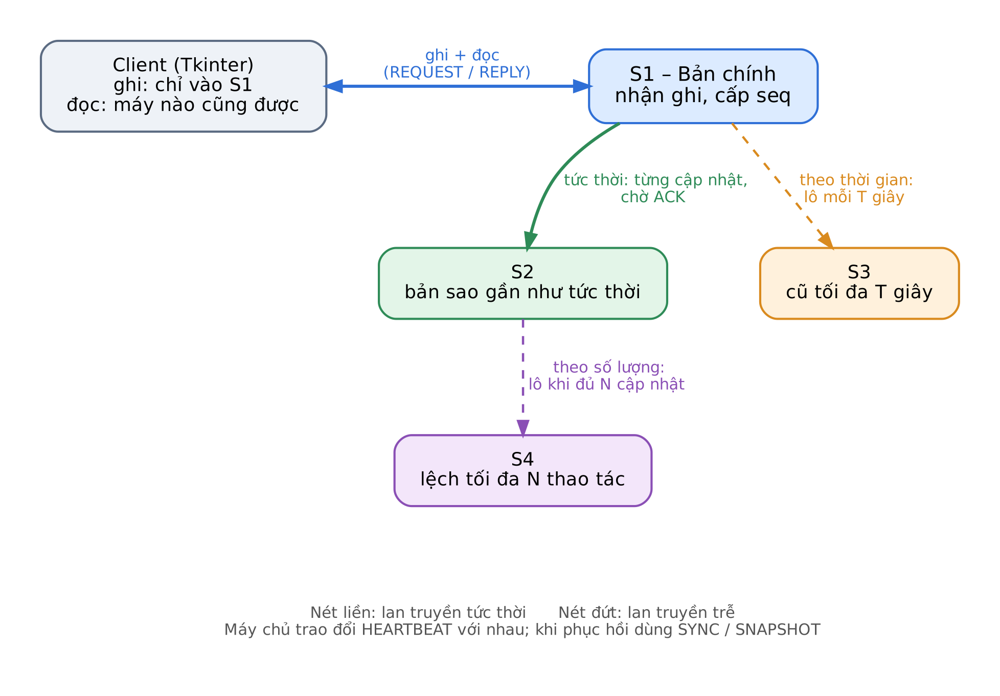

# CHTPT-CapNhat-LanTruyen

Hệ thống nhân bản dữ liệu kho hàng trên 4 máy chủ, có lan truyền cập nhật và phục hồi lỗi.

[](https://github.com/milanevn/CHTPT-CapNhat-LanTruyen/actions/workflows/ci.yml)   

Đồ án môn **Các hệ thống phân tán** · Đề tài 8

---

## Giới thiệu

Ứng dụng quản lý **nhập – xuất – tồn** hàng hóa, trong đó dữ liệu được nhân bản trên 4 máy chủ. Máy chủ S1 là bản chính, nhận mọi thao tác ghi và lan truyền cập nhật sang các bản sao theo ba chế độ khác nhau. Hệ thống tự phục hồi khi máy chủ sập, khi thông điệp bị mất hoặc khi dữ liệu bị hỏng.

Toàn bộ cơ chế nhân bản được tự cài đặt trên nền TCP socket và SQLite, không dùng tính năng replication có sẵn của hệ quản trị CSDL.

## Tính năng

**Nghiệp vụ kho**

- Thêm hàng hóa, nhập kho, xuất kho, xem tồn
- Không cho phép tồn âm, kể cả khi nhiều client xuất cùng lúc

**Lan truyền cập nhật**

| Đường   | Chế độ   | Điều kiện gửi                       |
| ------- | -------- | ----------------------------------- |
| S1 → S2 | Tức thời | Ngay sau mỗi cập nhật, chờ xác nhận |
| S1 → S3 | Định kỳ  | Mỗi **T** giây                      |
| S2 → S4 | Theo lô  | Khi đủ **N** cập nhật mới           |

N và T thay đổi được khi hệ thống đang chạy.

**Chịu lỗi và phục hồi**

- Truyền thông tin cậy: ACK, timeout, gửi lại, chống xử lý trùng
- Phát hiện máy chết / sống lại bằng heartbeat
- Máy khởi động lại tự xin gửi bù các cập nhật còn thiếu
- Khôi phục dữ liệu hỏng từ checkpoint và nhật ký cập nhật

## Kiến trúc



- **Một chương trình máy chủ, bốn vai trò:** S1–S4 chạy cùng mã nguồn, phân biệt bằng tham số `--node`.
- **Ghi tập trung, đọc phân tán:** client chỉ ghi vào S1, đọc được từ bất kỳ máy nào.
- **Nhật ký có đánh số:** mỗi cập nhật mang một số thứ tự `seq` do S1 cấp; mọi máy áp dụng đúng thứ tự, mỗi `seq` đúng một lần, nên các bản sao luôn hội tụ về cùng dữ liệu.
- **Độc lập dữ liệu:** mỗi máy có một file SQLite riêng.

## Công nghệ

| Thành phần   | Công nghệ                         |
| ------------ | --------------------------------- |
| Ngôn ngữ     | Python 3.10+ (chỉ thư viện chuẩn) |
| Giao diện    | Tkinter                           |
| Truyền thông | TCP socket, JSON                  |
| Lưu trữ      | SQLite                            |
| CI           | GitHub Actions                    |

## Bắt đầu nhanh

Yêu cầu: Windows, Python 3.10+.

```
git clone https://github.com/<user>/CHTPT-CapNhat-LanTruyen.git
cd CHTPT-CapNhat-LanTruyen

python scripts/run_all.py      # khởi động 4 máy
```
